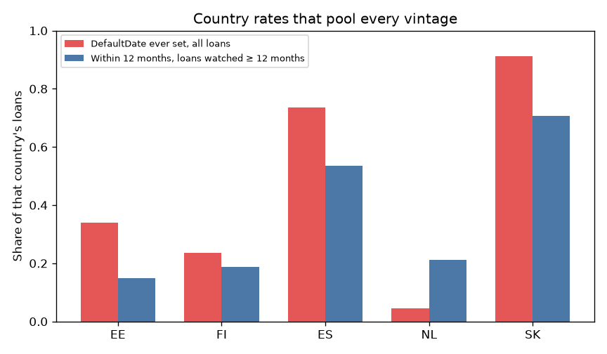
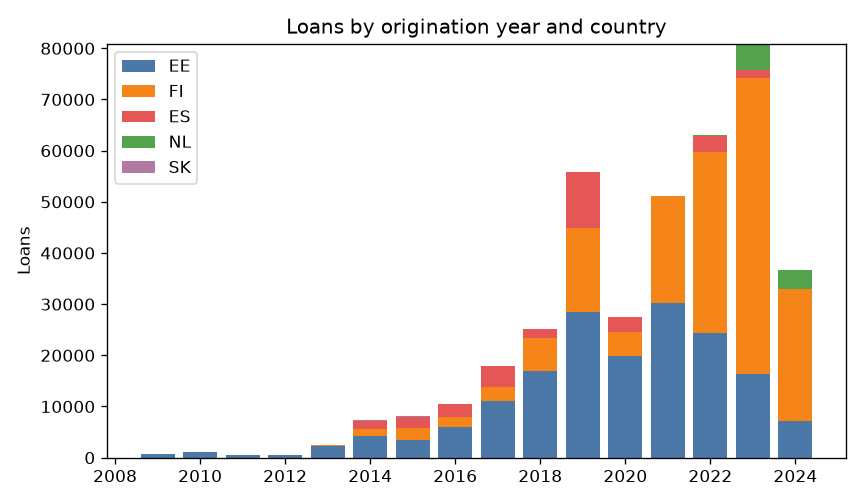
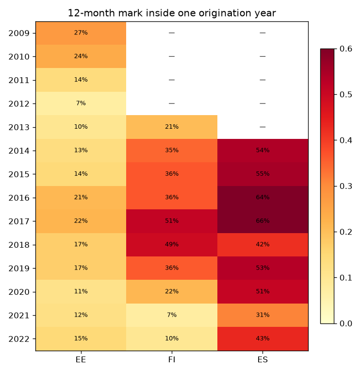

# Bondora extract: country is not the calendar

Note 4 of the Bondora loan book. Read [the default date](eda3.md) first.
The rate in the year panel is the working mark from that note: collection
started within 12 months of `LoanDate`. It is not the model target.
2023 and 2024 stay out of the compared rate.

Counts come from
`uv run python scripts/EDA_bondora/bondora_step4_country.py`.

## A pooled country rate mixes different books

| Country | Loans | % `DefaultDate` ever | Watched ≥ 12 months | % within 12 months |
|---------|------:|---------------------:|--------------------:|-------------------:|
| EE | 173,263 | 34.0 | 156,963 | 14.9 |
| FI | 175,798 | 23.7 | 116,398 | 18.7 |
| ES | 31,111 | 73.5 | 30,878 | 53.6 |
| NL | 9,056 | 4.5 | 1,007 | 21.3 |
| SK | 296 | 91.2 | 296 | 70.6 |

Finland's ever-rate sits below Estonia's. About half of Finnish loans
were issued in 2023-2024 (83,647 of 175,798). Those vintages have not
had time to collect an ever-rate. Estonia's share in those two years is
23,547 of 173,263. The Netherlands are 9,056 loans and only 1,007 of
them have been watched 12 months; on that slice the 12-month mark is
21%, not 4.5%. Slovakia is 296 loans.

## Who was lending, by year

2009-2012 are Estonia only. Finland and Spain are thin in 2013.
The Netherlands start in 2022. Slovakia is 293 loans in 2014 and 3 in
2015. From 2021 Finland is the largest slice of the new book.

## The same 12-month mark, inside one year

Cells with fewer than 100 loans are left blank. Slovakia and the
Netherlands are not in this panel.

| Year | EE | FI | ES |
|-----:|---:|---:|---:|
| 2014 | 13.3 | 34.6 | 53.9 |
| 2015 | 14.4 | 36.5 | 55.2 |
| 2016 | 21.3 | 36.5 | 63.5 |
| 2017 | 22.0 | 51.2 | 65.7 |
| 2018 | 16.9 | 49.4 | 41.7 |
| 2019 | 17.1 | 36.1 | 53.2 |
| 2020 | 11.5 | 21.5 | 50.8 |
| 2021 | 12.2 | 7.4 | 31.0 |
| 2022 | 14.6 | 9.8 | 43.0 |

Spain in 2021 is 145 loans. Every other Spain cell from 2014 to 2022
has at least 1,600.

Spain stays above Estonia in every year both have at least 100 loans.
The gap runs from about 25 points (2018) to about 44 points (2017).
Holding the year fixed does not pull Spain down to Estonia.

Finland sits above Estonia from 2014 through 2020, by 10 to 33 points,
and below Estonia in 2021 (7.4% against 12.2%) and 2022 (9.8% against
14.6%). In 2018 Finland (49.4%) is also above Spain (41.7%). The three
countries do not keep one ranking.

## What this leaves open

Slovakia's 2014 cell is 70.6% on 293 loans. The Netherlands' only
mature year is 2022, 29.6% on 243 loans. Both are described here and
left out of the comparison.

The level changes inside a single origination year, so country was not
a stand-in for the calendar. Finland's level relative to Estonia
changes side in 2021. A constant country effect is a hypothesis this
table already strains. Whether the slope of income or amount also
changes side is the association note. One model, or one model per
country, is not chosen here.
Next: [what was known on the loan day](eda5.md).
