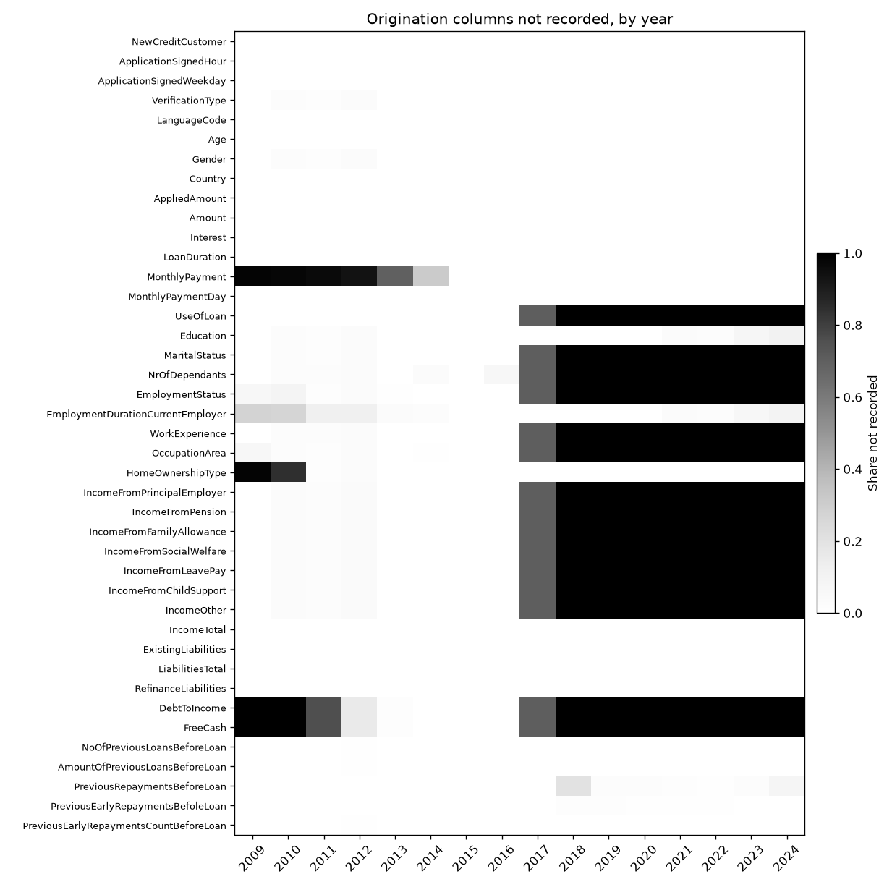
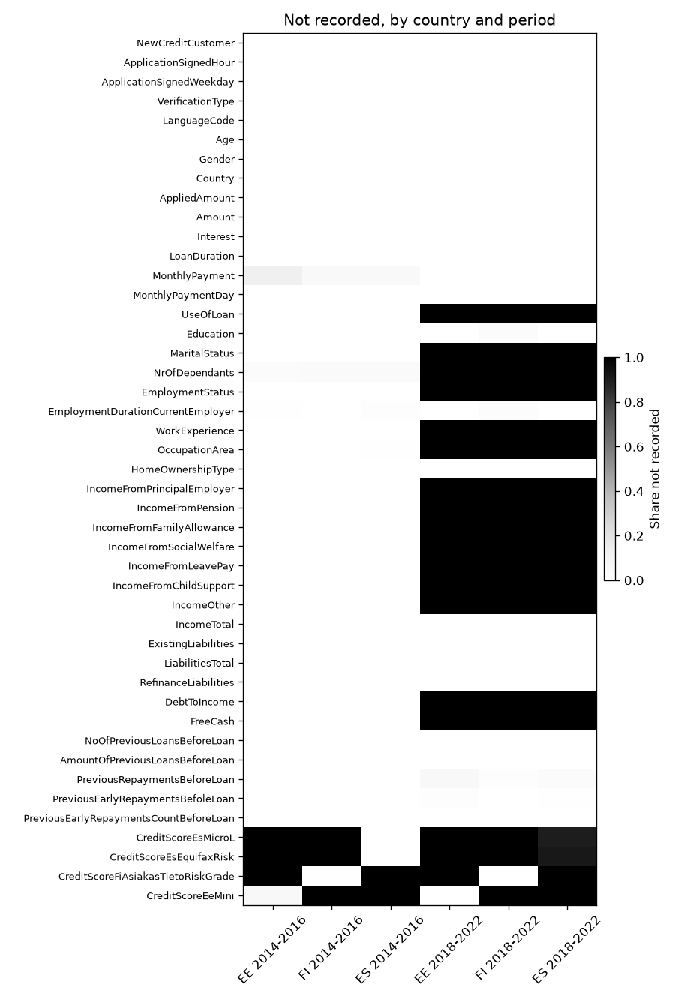

# Bondora extract: what was known on the loan day

Note 5 of the Bondora loan book. Read [country inside one year](eda4.md)
first. This note sorts the 112 columns by when they were written, and
shows where the application columns are actually filled.

Counts come from
`uv run python scripts/EDA_bondora/bondora_step5_inventory.py`.
The groups live in that script. It stops if the CSV gains, loses, or
renames a column.

## Six groups, every column once

| Group | Columns | What it holds |
|-------|--------:|---------------|
| Origination | 41 | The applicant and the contract on the day the loan was issued |
| One country | 4 | Credit bureau scores from Spain, Finland, or Estonia |
| Platform | 14 | Bondora's rating, its model outputs, and the investor bids on them |
| After disbursement | 39 | Arrears, balances, payments, recoveries, schedule changes |
| Reference | 10 | Ids and the dates that place a row: application, listing, issue, first payment, original maturity |
| Empty | 4 | `DateOfBirth`, `County`, `City`, `EmploymentPosition`: no value in any row |

A column whose timing is unclear goes to "after disbursement" until shown
otherwise. `NrOfScheduledPayments` is one: it matches `LoanDuration` on
only 40% of the rows where it is filled, so it follows the schedule as it
is now, not as it was signed.

The platform group includes the three bid columns. Investors bid after
seeing Bondora's rating, so the bids are the market's reading of that
score, not a fact about the applicant. They also stop covering the loan:
the median share of the amount covered by bids is 100% through 2017, 75%
in 2018, 48% in 2019, 3% in 2022, and 0 in 2023-2024.

`Interest` and `MonthlyPayment` stay in origination with a flag. They are
fixed on the loan day, but Bondora sets the rate from its own rating.
Tying them to default partly measures that rating.

## Not recorded is not the same as empty

Bondora writes "not collected" in several ways. The script counts a cell
as not recorded when it is:

- empty;
- `-1` in a coded category (`UseOfLoan`, `Education`, `MaritalStatus`,
  `EmploymentStatus`, `OccupationArea`, `HomeOwnershipType`);
- `M` in the Spanish `CreditScoreEsMicroL`. Every Estonian, Finnish, and
  Dutch loan carries that placeholder;
- 0 in `DebtToIncome` or `FreeCash`. From 2014 to 2016 a zero almost
  never occurs;
- 0 in every part of the income breakdown at once. One zero part, such
  as no pension, is a real value.

From 2018 an empty `PreviousRepaymentsBeforeLoan` means zero: in
2018-2024 it is empty for 99% of first-time borrowers and for 6% of
returning ones. Before 2018 first-time borrowers had a written 0. The
same holds for the early-repayment amount next to its count. Both count
as not recorded only when the count beside them is above zero.

## The application shrank on 1 June 2017

`UseOfLoan` is coded on loans issued up to 2 June 2017 and is `-1` from
1 June 2017. From that week on, fifteen origination columns are never
recorded again:

- `UseOfLoan`, `MaritalStatus`, `NrOfDependants`, `EmploymentStatus`,
  `WorkExperience`, `OccupationArea`;
- the seven parts of the income breakdown;
- `DebtToIncome` and `FreeCash`.

`IncomeTotal`, the liabilities, `Education`, `HomeOwnershipType`, and the
history of previous loans stay. So do amount, term, rate, age, and
country.

Of the 271,955 loans issued in 2009-2022, 235,385 (86.6%) come after the
cut. The full application covers 36,570 loans, and most of the
three-country part of those is 2014-2016:

| Year | EE | FI | ES |
|-----:|---:|---:|---:|
| 2014 | 4,145 | 1,408 | 1,609 |
| 2015 | 3,432 | 2,424 | 2,187 |
| 2016 | 6,023 | 1,849 | 2,642 |

The early years have their own holes. `MonthlyPayment` is empty on most
loans through 2013, `HomeOwnershipType` through 2010, and `DebtToIncome`
and `FreeCash` through 2011.

## The same picture inside each country

The cut hits Estonia, Finland, and Spain alike. No country keeps the
dropped fields after 2017, and none is missing a field the others have.
Outside the cut, the largest gap is `MonthlyPayment` in Estonia in
2014-2016, not recorded on 12% of loans. Every other origination column
is filled on at least 95% of the loans of each country and period.

## One-country scores

| Score | Country | Filled |
|-------|---------|--------|
| `CreditScoreEeMini` | EE | 83% in 2014, 99-100% from 2015 |
| `CreditScoreFiAsiakasTietoRiskGrade` | FI | 87% in 2013, 96-100% from 2014 |
| `CreditScoreEsMicroL` | ES | Through 2018, then 2% in 2019 and none after |
| `CreditScoreEsEquifaxRisk` | ES | Through 2018 (95% that year), none after |

Each score is empty outside its country, by design. A correlation across
the whole book would mostly measure which country a loan is from. The
Spanish scores also end with 2018, so Spain after 2018 has no bureau
score in this extract.

## The window from here on: 2018-2022

The book offers two windows with different columns:

- **2014-2016, full application.** All 41 origination columns, plus the
  bureau score of each country. From 5,681 loans (Finland) to 13,600
  (Estonia).
- **2018-2022, reduced application.** 26 origination columns: amount,
  term, rate, payment and payment day, age, gender, country, language,
  education, employment duration, home ownership, `IncomeTotal`,
  liabilities, verification, application hour and weekday, new or
  returning customer, and earlier loans. Plus the Estonian and Finnish
  scores.

The later steps use **2018-2022 only**. An application scored today
looks like the second window: the dropped fields will never arrive.
The platform also looks like today's from 2018: Bondora sets the rate
(since 2015) and Go & Grow funds the loans (since June 2018, see
[how the platform works](platform.md)). And the window is large:
222,765 loans, 119,991 in Estonia, 83,655 in Finland, 18,876 in Spain.

What that costs is written down, not hidden. Purpose, marital status,
employment status, and `DebtToIncome` are never examined, so this repo
cannot say whether they would have helped. Starting on 1 June 2017
instead would add 12,620 loans with the same columns; whole calendar
years are kept for simplicity.

Two cautions travel with the window. Spain has 145 loans in 2021 and
no bureau score after 2018, so a Spanish comparison inside one year is
only solid in 2019 and 2022. And the 12-month mark moves from 29.7% in
2019 to 10.3% in 2021 inside the same window.

The platform group and the after-disbursement group are not crossed in
step 6. Step 7 measures them against the same mark to show why they stay
out.
